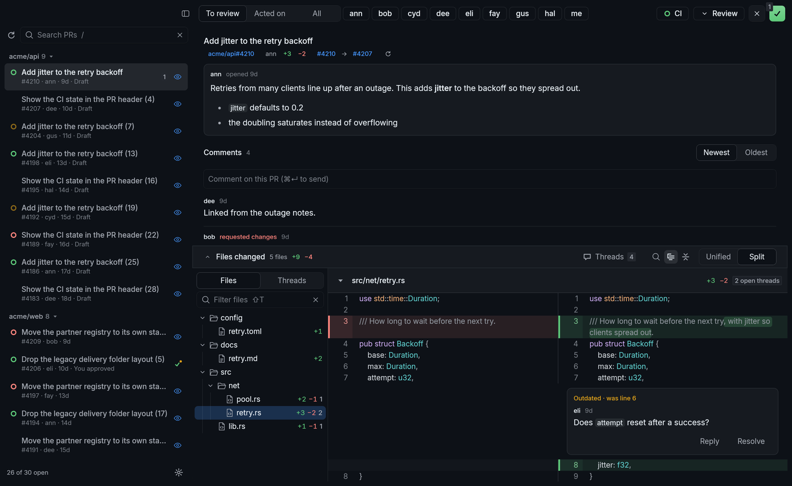

# Catnip

A desktop app to review GitHub pull requests from the keyboard. It is written in Rust with
[Rune](https://github.com/anomalyco/rune).



- It lists the open PRs of the orgs, users or repositories you pick, with their CI state and
  your review state.
- It shows the conversation, the diff and the review threads of a PR in one window.
- You can approve, comment, reply to and resolve threads, and run CI again.
- Press `?` to see the keys. A cat lives in it.

## Run

Catnip reads a GitHub token from `GITHUB_TOKEN`, or from `gh auth token`.

```sh
cargo run --release
```

On Linux, `mise run desktop` installs a launcher and the icon.

## License

MIT
